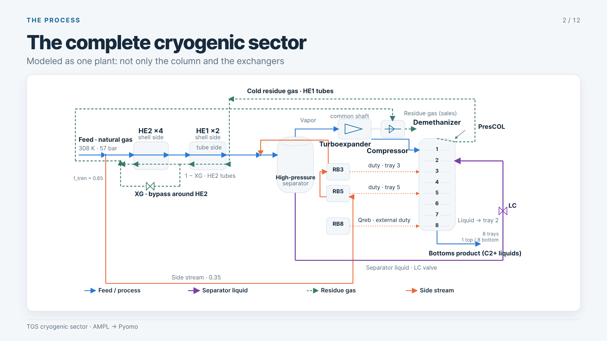
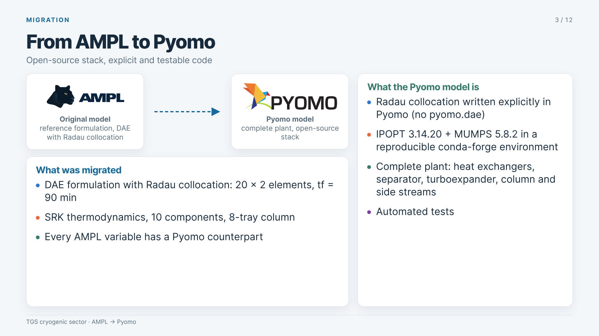
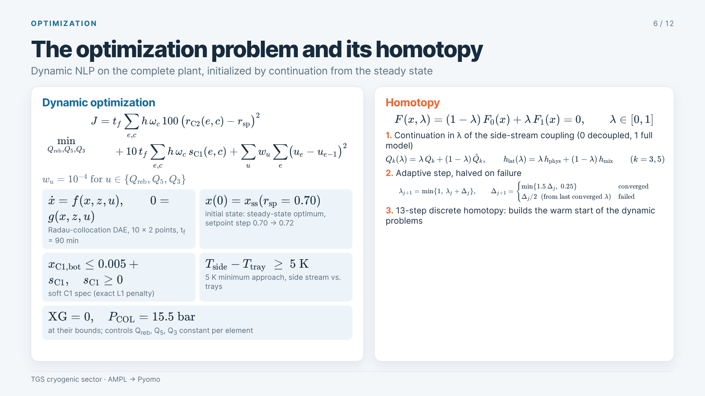
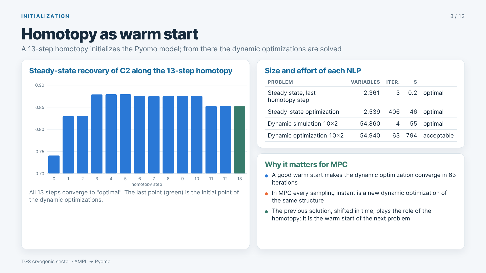

# Cryogenic Gas Separation Plant: Dynamic Optimization in Pyomo

**A plant-wide, equation-oriented model of a natural-gas cryogenic separation sector (TGS), migrated from AMPL to Pyomo and solved as a large-scale dynamic NLP with an open-source stack.**

> 🇪🇸 Modelo riguroso de todo el sector criogénico de una planta de separación de gas natural (TGS), migrado de AMPL a Pyomo y resuelto como un problema de optimización dinámica de gran escala con herramientas open-source.

   

> ℹ️ This repository is a **showcase**. The model source code, plant data and detailed results are not public.

---

## Highlights

- **Complete plant, not just the column.** Heat-exchanger trains, high-pressure separator, turboexpander/compressor, demethanizer with side reboilers and side streams, all coupled in a single model.
- **Faithful AMPL → Pyomo migration.** Every AMPL variable has a Pyomo counterpart; the migrated model reproduces the reference solution and closes the mass and energy balances to machine precision.
- **Dynamic optimization at scale.** DAE model discretized with Radau collocation: **~55,000 variables** solved with IPOPT + MUMPS.
- **Homotopy-based initialization.** A continuation strategy takes the model from a decoupled problem to the fully coupled plant and provides the warm start for the dynamic problems. The same idea carries over to MPC.
- **Fully open-source and reproducible.** Python, Pyomo, IPOPT and MUMPS in a conda-forge environment, with automated tests.

---

## The process

The model covers the whole cryogenic sector: feed gas cooling in parallel heat-exchanger trains, a high-pressure flash separator, turboexpander and compressor on a common shaft, and a demethanizer column with side reboilers fed by process side streams. Thermodynamics use the **Soave–Redlich–Kwong (SRK)** equation of state.

## From AMPL to Pyomo

The original formulation, a DAE in AMPL with Radau collocation, was migrated equation by equation to Pyomo:

- Radau collocation written explicitly in Pyomo
- SRK thermodynamics with explicit selection of the cubic root
- Consistent units and explicit parameters
- Verification against the AMPL solution: same degrees of freedom, same objective, residuals and balance errors at machine precision

## The optimization problem and its homotopy

The dynamic optimization is a DAE-constrained NLP over the complete plant. To reach it, a homotopy continuously couples the side streams into the model, from a decoupled problem ($\lambda = 0$) to the full plant ($\lambda = 1$), with an adaptive step that is halved on failure.

## Homotopy as warm start

Converging a plant-wide, highly coupled NLP from scratch is hard. The model is initialized by **continuation** from a simpler, decoupled problem to the full plant, using an adaptive step. The converged steady state is then the starting point for the dynamic optimizations.

---

## Some of the math

**Homotopy.** A family of problems that blends a decoupled model $F_0$ into the full plant model $F_1$:

$$
F(x,\lambda) = (1-\lambda)\,F_0(x) + \lambda\,F_1(x) = 0, \qquad \lambda \in [0,1]
$$

with an adaptive step that grows on success and is halved on failure:

$$
\lambda_{j+1} = \min(1,\ \lambda_j + \Delta_j), \qquad
\Delta_{j+1} =
\begin{cases}
\min(1.5\,\Delta_j,\ \Delta_{\max}) & \text{converged} \\
\Delta_j / 2 \ \text{(from the last converged } \lambda) & \text{failed}
\end{cases}
$$

**Dynamic model.** A semi-explicit index-1 DAE

$$
\dot{x} = f(x, z, u), \qquad 0 = g(x, z, u), \qquad x(0) = x_{ss}
$$

discretized by Radau collocation on finite elements.

**Optimal control problem.** Tracking of a product-recovery setpoint, with a soft (exact $\ell_1$) product specification and move suppression on the manipulated heat duties:

$$
\min_{u}\; \sum_{e,c} \big(r(e,c) - r_{sp}\big)^2 \;+\; \rho \sum_{e,c} s(e,c) \;+\; \sum_{u} w_u \sum_e \big(u_e - u_{e-1}\big)^2
$$

$$
\text{s.t.}\quad x_{C_1,\text{bot}} \le x_{C_1}^{\max} + s, \qquad s \ge 0
$$

**Thermodynamics.** SRK cubic in the compressibility factor, with the physically correct root selected:

$$
Z^3 - Z^2 + Z\,(A - B - B^2) - AB = 0
$$

---

## Stack

| Layer | Tool |
|---|---|
| Modeling | Pyomo |
| NLP solver | IPOPT (interior point) |
| Linear algebra | MUMPS (sparse direct) |
| Environment | conda-forge, Python 3.11 |

## What comes next

The dynamic NLP is already, in structure, a model predictive control problem. Next steps are calibration against plant data, economic optimization, and MPC with a receding horizon, where the previous solution shifted in time plays the role of the homotopy warm start.

---

**Juan Laigle**: process modeling and optimization. Contact via [GitHub](https://github.com/juanlaigle-hub).

© All rights reserved. Images and content may not be reused without permission.
